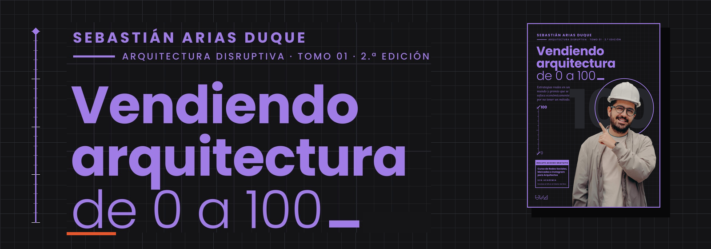
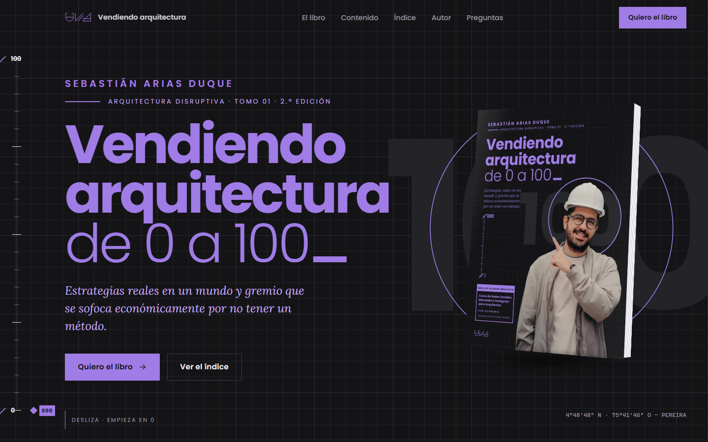
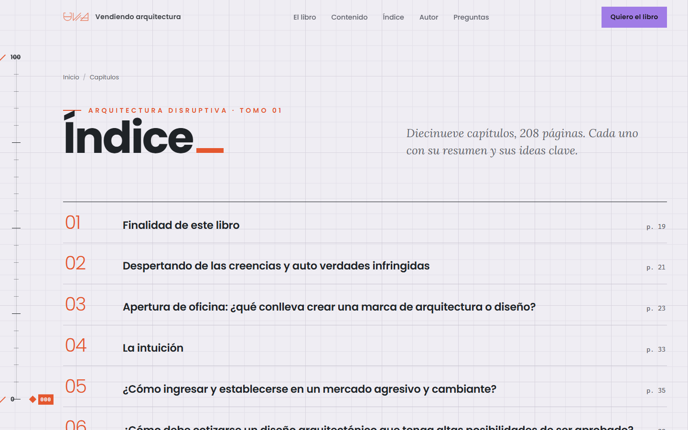
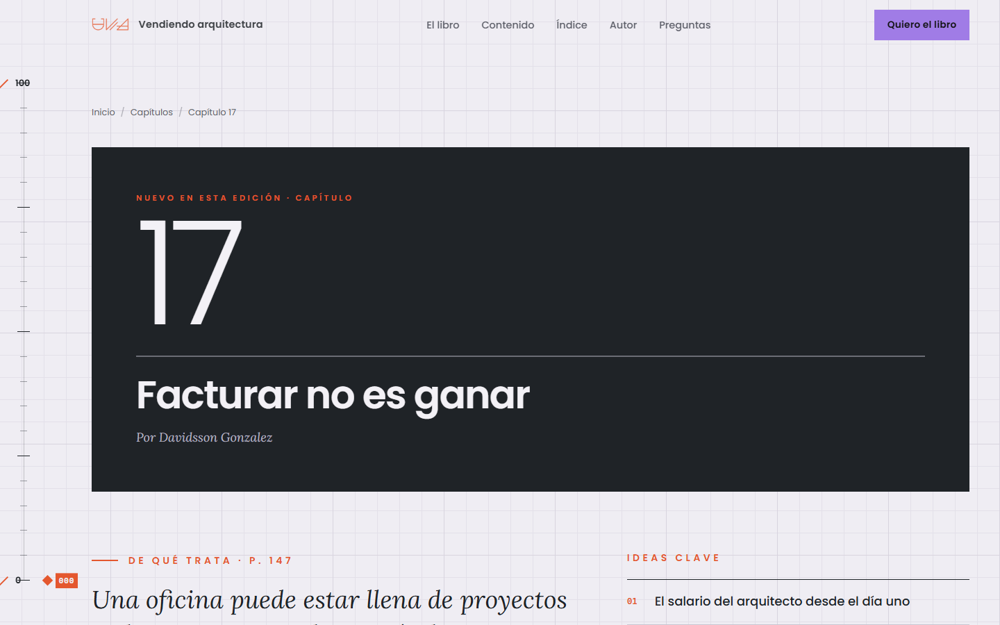
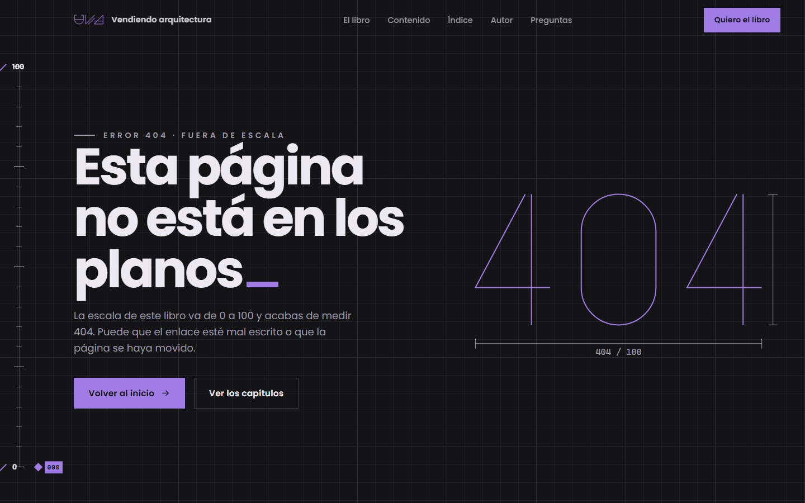
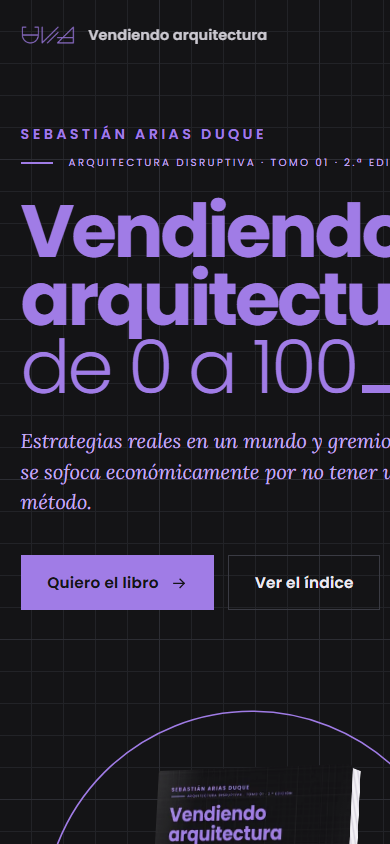

<div align="center">



### Sitio web interactivo del libro · Editorial UVA

*Estrategias reales en un mundo y gremio que se sofoca económicamente por no tener un método.*

**[▶ Ver la vista previa en vivo](https://kin9zeus.github.io/Vendiendo-Arquitectura-de-0-a-100-web-interactiva/)**


[](https://github.com/Kin9Zeus/Vendiendo-Arquitectura-de-0-a-100-web-interactiva/actions/workflows/pages.yml)

</div>

---

## El proyecto

**Vendiendo arquitectura de 0 a 100** es el primer tomo de la colección *Arquitectura Disruptiva* del arquitecto **Sebastián Arias Duque**, fundador de UVA Arquitectura (Pereira, Colombia). El libro enseña lo que la academia omite: cómo abrir una oficina, cotizar para que te aprueben, firmar el contrato correcto, cobrar la visualización, hacer mercadeo y administrar el dinero de una práctica de arquitectura.

Este repositorio contiene su **sitio oficial**: una experiencia editorial de una sola narrativa que traslada el objeto físico —tapa dura negra con retícula de plano, tinta violeta, páginas interiores color papel— a la pantalla, y la convierte en un recorrido de **0 a 100** guiado por el scroll.

**Objetivo del sitio:** que arquitectos, diseñadores, constructores y estudiantes de Latinoamérica entiendan en un minuto qué resuelve el libro, confíen en quien lo escribió y lo pidan.

<div align="center">

</div>

---

## Concepto de diseño

> **La regla de la portada se convierte en la interfaz.**
> La cubierta del libro tiene un escalímetro vertical que va de 0 a 100. En el sitio esa regla vive fija en el margen y se llena a medida que lees: cada sección es una cota más en el camino de 0 a 100.

Toda decisión visual sale del libro impreso, no de una plantilla:


| Token | Color | De dónde sale |
|---|---|---|
| Tinta | `#141416` | Fondo de la sobrecubierta, muestreado del archivo de imprenta |
| Violeta | `#A07CE6` | Tinta del título en la portada |
| Papel | `#EFEDF3` | Páginas interiores: el sitio «abre el libro» al llegar al índice |
| Apertura | `#1F2327` | Bloques de inicio de capítulo del interior |
| Señal | `#E4572E` | El guion bajo «_» y los números de capítulo del interior |

- **Tipografía:** Poppins (titulares, en los mismos pesos 700/300 de la portada) + Lora itálica (la voz editorial del libro). Autoalojadas.
- **Lenguaje de plano:** retícula de 32/160 px, cotas que se trazan en las cifras, un cajetín de plano como ficha técnica, esquinas de registro en las tarjetas y las coordenadas reales de Pereira en la portada.
- **El cursor «_»:** el guion bajo que cierra cada título del libro parpadea al final de los titulares del sitio.

---

## Recorrido

| # | Sección | Qué ocurre |
|---|---|---|
| 0 | **Precarga** | Un contador recorre `000 → 100_` y la cortina se levanta (solo al llegar desde fuera del sitio). |
| 1 | **Portada** | El título sube línea a línea, el círculo de la cubierta se dibuja y el libro entra en 3D; después sigue al puntero. |
| 2 | **Contraportada** | La sección se fija; las palabras del texto de contracubierta se encienden una a una mientras el libro gira 180° y muestra su reverso. |
| 3 | **Lo que encontrarás** | Scroll horizontal: siete tarjetas de plano cuyos dibujos se trazan al entrar, cada una enlazada a su capítulo. |
| 4 | **Facturar no es ganar** | La «escalera financiera de 0 a 100» del capítulo 17: cinco volúmenes isométricos crecen con el scroll y la lectura sube de 000 a 100. |
| 5 | **Cifras** | Líneas de cota que se trazan y números que cuentan. |
| 6 | **Índice** | El fondo pasa a papel; las filas imitan la apertura de capítulo del libro al pasar el cursor. |
| 7 | **Pregúntale al libro** | Asistente con IA que solo conoce este libro: explica ideas, relaciona capítulos y cita la fuente. |
| 8 | **Autor, prólogo, curso incluido, ficha técnica y preguntas** | Revelados con máscara, marcos que se dibujan y un acordeón accesible. |
| 9 | **Cierre** | «Hay un antes y un después_» y una marquesina que se inclina con la velocidad del scroll. |

Además: 19 páginas de capítulo con su resumen e ideas clave, un índice completo, páginas legales (privacidad, términos y cookies) y una **404 propia** que se sale de la escala: *404 / 100*.

<table>
  <tr>
    <td width="50%"></td>
    <td width="50%"></td>
  </tr>
  <tr>
    <td width="50%"></td>
    <td width="50%" align="center"></td>
  </tr>
</table>

---

## Pregúntale al libro — asistente con IA

Un asistente conversacional integrado en el sitio que **solo responde sobre el contenido del libro**. Su propósito es que el lector profundice antes y después de comprarlo, sin convertirse en un consultor de propósito general.

| Capacidad | Cómo se logra |
|---|---|
| Responde con el libro, no de memoria | *Retrieval-augmented generation*: cada pregunta recupera los fragmentos más afines (BM25 en español + embeddings `gemini-embedding-001`, fusionados por *Reciprocal Rank Fusion*) y el modelo responde solo con ellos y con el mapa de capítulos. |
| Cita la fuente | Cada respuesta muestra los capítulos consultados con enlace a su página. |
| Fuera de tema, fuera de juego | Instrucciones de alcance estricto, detección de intentos de *prompt injection* antes de llamar al modelo y fragmentos delimitados como datos, nunca como órdenes. |
| No regala el libro | Prohibido reproducir párrafos, tablas o capítulos: resume, explica e invita a la lectura. |
| Solo texto | Sin adjuntos, imágenes, herramientas ni enlaces; el cliente bloquea archivos pegados o arrastrados y el servidor rechaza contenido codificado. |
| Memoria efímera | La conversación vive en la memoria de la pestaña: sin cookies ni almacenamiento local; al recargar o cerrar desaparece. |
| Historial a prueba de manipulación | Cada respuesta del asistente se firma con HMAC; el servidor rechaza historiales alterados. |
| Costo controlado | `gemini-3.5-flash-lite` con razonamiento mínimo, respuestas acotadas, ventana de contexto deslizante y caché implícito del prompt fijo. |
| Uso justo | Límite diario por visitante, por IP y por minuto; tope global de mensajes y tokens; una respuesta a la vez; interruptor de apagado. |
| Privacidad por diseño | Correos y teléfonos se ocultan antes de llegar a la IA; contadores con seudónimos HMAC que rotan cada día; registros sin contenido ni IP. |

**Modo demostración:** si la IA no está disponible (vista previa estática, desarrollo sin clave o servicio apagado), el chat no se bloquea: responde sin IA con el índice, los resúmenes y las ideas clave de cada capítulo, y lo indica con claridad.

**Contenido protegido:** el repositorio es público, así que la base de conocimiento del libro se guarda cifrada con **AES-256-GCM** (`server/data/kb.enc`) y solo se descifra en memoria en el servidor con una clave de entorno.

```
Navegador ──POST /api/chat (texto + historial firmado)──▶ Servidor Node
                                                            ├─ validación · origen · límites · minimización de datos
                                                            ├─ recuperación híbrida en la base cifrada
                                                            └─ Gemini (SSE) ──▶ respuesta en streaming + firma
```

## Ingeniería

### Stack
| Capa | Tecnología |
|---|---|
| Framework | **Astro 7** en modo estático: HTML prerenderizado, cero JS por defecto, imágenes AVIF/WebP responsivas |
| Movimiento | **GSAP 3.15** (ScrollTrigger, SplitText) + **Lenis** para scroll suave, sincronizados en un solo ticker |
| Servidor | **Node.js** + `sirv` (única dependencia de producción); API del asistente sin SDK, con `fetch` y SSE |
| IA | **Gemini API** (`gemini-3.5-flash-lite`, respaldo `gemini-3.1-flash-lite`) + `gemini-embedding-001` |
| Calidad | Pruebas con `node:test`: unidades de seguridad y límites + integración contra un Gemini simulado |
| Infraestructura | **Docker** multi-etapa en **Railway**, dominio en GoDaddy |
| Recursos | Script en Python (Pillow) que recorta portada, lomo, contraportada y retrato del archivo de imprenta y genera la imagen social y los iconos |

### Rendimiento
- ~140 kB en total con brotli; HTML, CSS y JS precomprimidos en el build (brotli 11 + gzip 9).
- Fuentes autoalojadas con métricas de respaldo ajustadas para evitar saltos de diseño.
- Caché inmutable de un año para recursos con hash; HTML siempre revalidado.
- Secciones fijadas solo en escritorio (`gsap.matchMedia`); en móvil las mismas historias se cuentan sin pin.

### Seguridad
- **Content-Security-Policy con hashes SHA-256** generados en el build: sin `unsafe-inline`, sin estilos en línea, sin terceros.
- Cabeceras: HSTS con *preload*, `X-Frame-Options`, `Referrer-Policy`, `Permissions-Policy` restrictiva, COOP/CORP, `Origin-Agent-Cluster`.
- Servidor endurecido: solo `GET`/`HEAD`, protección contra *path traversal*, redirección 301 a host canónico HTTPS y URLs limpias, 404 real, timeouts y *healthcheck*.
- Sin cookies, sin almacenamiento en el navegador, sin formularios ni analítica de terceros.
- API del asistente: verificación de `Origin` y `Sec-Fetch-Site`, solo JSON, límite de tamaño del cuerpo, `Retry-After` en 429, cancelación aguas arriba si el usuario cierra, y la clave de la IA solo en el servidor, enviada por cabecera.
- Contenedor sin privilegios (`USER node`) e instalación de producción con `npm ci --omit=dev`.

### SEO y GEO
- Datos estructurados: `Book` (con los 19 `Chapter`), `Person`, `Organization`, `FAQPage`, `BreadcrumbList`, `ItemList`.
- Una URL indexable por capítulo, sitemap, canonical, Open Graph y tarjeta social con la portada.
- **Optimización para motores generativos:** `/llms.txt` con el resumen del libro y `robots.txt` abierto a los rastreadores de asistentes de IA.

### Legal y cumplimiento
- Política de privacidad y tratamiento de datos conforme a la **Ley 1581 de 2012** (Colombia), con apartados para **RGPD** y **CCPA**, transferencias internacionales y plazos de respuesta.
- Términos de uso con condiciones del asistente: mayoría de edad, uso aceptable, no asesoría profesional y derechos del consumidor (**Ley 1480 de 2011**).
- Política de cookies y aviso explícito de interacción con IA, con consentimiento antes del primer mensaje.

### Accesibilidad
- HTML semántico con *landmarks*, enlace para saltar al contenido, foco visible y navegación completa por teclado.
- Todo el contenido es visible sin JavaScript; las animaciones se muestran en todos los dispositivos, incluso con la opción de reducir movimiento del sistema.
- Menú móvil con `aria-expanded`, cierre con `Esc` y gestión de foco.
- Asistente en un `<dialog>` modal nativo con registro `aria-live`, foco gestionado y controles de 44 px.

---

## Estructura

```
src/
├── config/site.ts        URL canónica, contacto y canal de venta
├── data/book.ts          Fuente única del contenido: libro, capítulos, escalera, FAQ
├── layouts/Base.astro    <head>: SEO, Open Graph, JSON-LD y arranque
├── components/           Nav, Footer, escalímetro, libro 3D, lista de capítulos
├── pages/                Inicio, capítulos, 404, legales, robots.txt, llms.txt
├── scripts/main.ts       Motor de interacción (Lenis + GSAP)
├── scripts/chat.ts       Cliente del asistente (carga diferida)
└── styles/               Sistema de diseño y estilos del asistente
server/chat/              API del asistente: recuperación, Gemini, límites, guardas
server/data/kb.enc        Base de conocimiento cifrada
server.mjs                Servidor de producción
scripts/                  Recursos, precompresión y construcción de la base
test/                     Pruebas unitarias y de integración
```

## Desarrollo

```bash
npm install
npm run dev        # http://localhost:4321
npm run build      # build estático + brotli/gzip
npm start          # servidor de producción en $PORT (8080)
npm test           # pruebas del asistente
npm run kb:build   # reconstruye la base cifrada (requiere el PDF original, no incluido)
```

### Vista previa en GitHub Pages

Cada push a `main` ejecuta las pruebas y publica una versión estática en **[https://kin9zeus.github.io/Vendiendo-Arquitectura-de-0-a-100-web-interactiva](https://kin9zeus.github.io/Vendiendo-Arquitectura-de-0-a-100-web-interactiva/)** mediante GitHub Actions (`.github/workflows/pages.yml`). Se compila con la subcarpeta del repositorio (`BASE_PATH`) y en modo vista previa (`PUBLIC_PREVIEW=true`): no se indexa en buscadores y el asistente funciona en modo demostración (sin IA), porque Pages no ejecuta el servidor. La versión completa vive en Railway.

### Despliegue en Railway

El repositorio incluye `Dockerfile` y `railway.json` (healthcheck en `/healthz`). Variables del servicio:

| Variable | Ejemplo | Uso |
|---|---|---|
| `SITE_URL` | `https://www.dominio.com` | Canonical, sitemap y redirección de host |
| `ALLOW_HOSTS` | `app.up.railway.app` | Hosts de prueba que no se redirigen |
| `NODE_ENV` | `production` | Activa HSTS y `upgrade-insecure-requests` |
| `GEMINI_API_KEY` | — | Clave de Google AI Studio (proyecto con facturación) |
| `KB_KEY` | — | Clave AES de la base de conocimiento |
| `CHAT_SECRET` | — | Clave HMAC para firmar el historial |
| `CHAT_DAILY_LIMIT` | `25` | Preguntas por visitante al día (más límites en `.env.example`) |

---

## Historial

| Versión | Fecha | Cambios |
|---|---|---|
| **1.1.3** | Oct 2026 | Animaciones visibles en todos los dispositivos, también cuando el sistema tiene activada la opción de reducir movimiento. |
| **1.1.2** | Oct 2026 | Modo demostración del asistente: cuando la IA no está disponible, el chat sigue permitiendo escribir y usar las sugerencias, con respuestas basadas en el índice del libro. |
| **1.1.1** | Oct 2026 | Vista previa pública en GitHub Pages con despliegue automático, rutas compatibles con subcarpeta y ajuste del menú en escritorio estrecho. |
| **1.1.0** | Oct 2026 | Asistente «Pregúntale al libro» con IA (RAG sobre base cifrada, streaming, límites de uso y seguridad), políticas de privacidad, términos y cookies, sitio sin almacenamiento en el navegador y suite de pruebas. |
| **1.0.0** | Oct 2026 | Lanzamiento: sitio completo con 23 páginas, sistema de diseño del libro, animaciones de scroll, servidor endurecido, SEO/GEO y despliegue en Railway. |

---

<div align="center">

**Diseño y desarrollo web:** [Kin9Zeus](https://github.com/Kin9Zeus)
**Libro:** Sebastián Arias Duque · Editorial UVA · UVA Arquitectura, Pereira, Colombia

<sub>El contenido del libro, sus textos, imágenes y marca pertenecen a sus autores y a Unidad Vectorial de Arquitectura S.A.S. Todos los derechos reservados.</sub>

</div>
